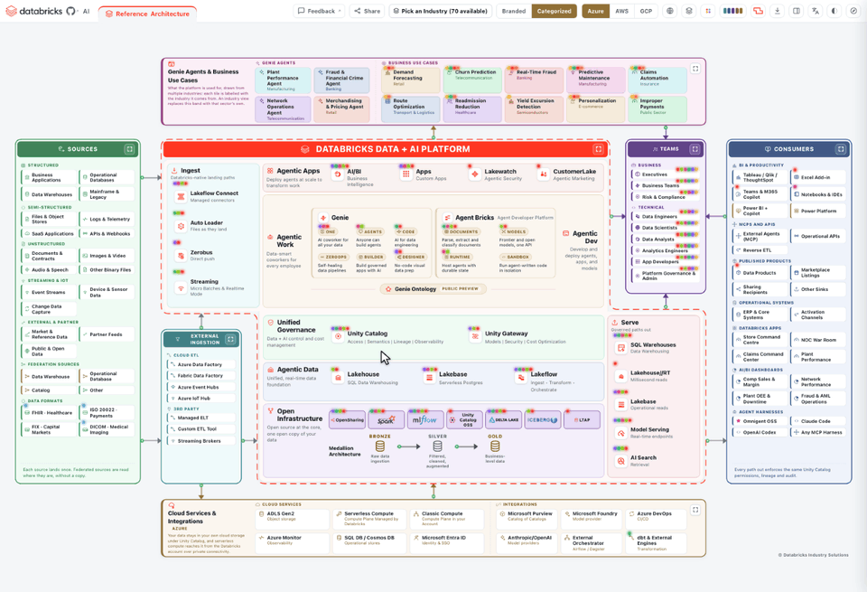
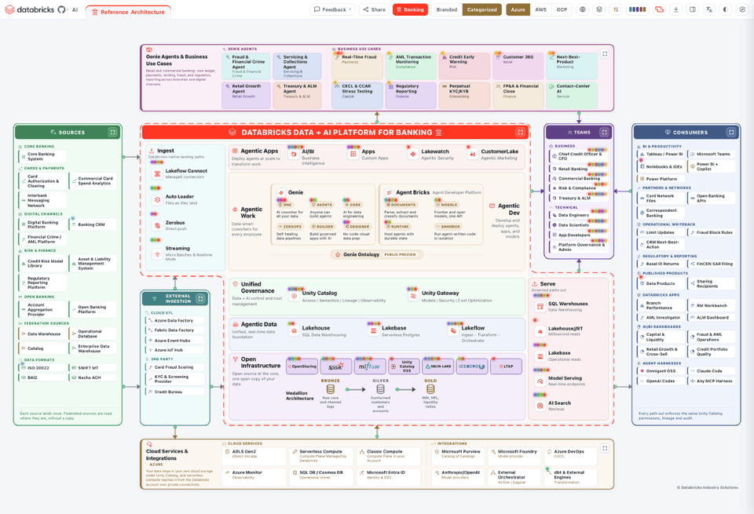
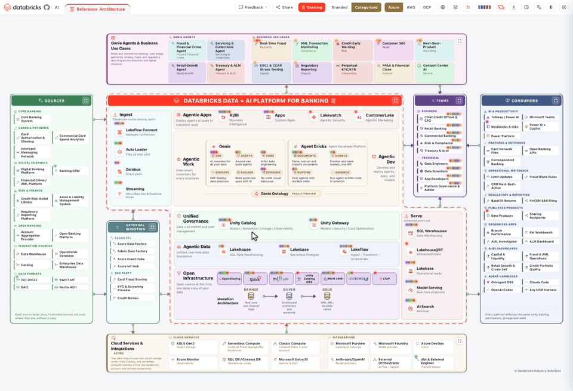

# Databricks Reference Architecture

An interactive reference architecture for the Databricks Data + AI Platform, specialized for
seventy industries on Azure, AWS and GCP, in sixteen languages. Click any box to see what it
is, who uses it and where it runs, then export the board as a deck or an editable diagram.

**[Open the live board](https://databricks-industry-solutions.github.io/databricks-reference-architecture/)**



## Features

### Seventy industries

- **Seventy industries** plus the Standard Reference Architecture, in a searchable picker. Each
  one specializes the sources, ingestion, teams, consumers, use cases and apps; the platform in
  the middle stays the same.
- **Every board** carries ten use cases, four Genie Agents, four AI/BI dashboards and four
  Databricks Apps written for that industry. Use cases with a Databricks customer story come first.
- **Medallion layers** in the industry's own terms, linked to its model in the
  [Databricks Industry Data Models](https://github.com/databricks-industry-solutions/lakehouse-industry-data-models).
- **Data formats** the industry exchanges, such as FHIR, ISO 20022, FIX and DICOM, each linked to
  its standards body.



### Simplified or Detailed

- **Simplified**, the default, keeps what you need to read the industry: the first entries of
  each group, the systems the industry can't be read without, such as a bank's core
  banking system or a hospital's electronic health record, the use cases with Databricks customer
  stories, and the cloud services for storage, identity, the catalog, model providers, BI, ETL and
  streaming.
- **Detailed** adds everything else: the remaining sources, teams, consumers, use cases and cloud
  services, including CI/CD, monitoring, operational stores and orchestrators, with their captions,
  capability tags and descriptions.
- The Databricks Platform in the middle shows the same products in both views. Your choice is
  remembered, a shared link opens in the same view, and every export follows what is on screen.
  A Simplified PowerPoint or PDF sets the platform's names one step larger and the Genie and
  Agent Bricks chips at 7pt, so they read at page size.

### Click any box

- **Products:** what it is, what the name does not tell you, its capabilities, the docs for your
  cloud, tours, demos, free Academy courses, certifications, videos and related boxes.
- **Use cases:** the problem, who benefits, how it is built, the components it uses, customer
  stories and solution accelerators.
- **Teams:** the personas inside, the capabilities they use, the use cases they own, and a
  learning track with certifications.
- **Sources:** what the system does, who uses it and the data it sends: batch or streaming, its
  shape, volume and cadence.
- **Genie Agents and dashboards:** the data an agent reads, its teams and top questions, and the
  KPIs a dashboard tracks.
- Every chip in a panel links onward, every box is reachable by keyboard, and Escape closes the panel.



### Your cloud, region and release stage

- **Cloud:** Azure, AWS or GCP redraws the cloud services and ingestion, and points every docs
  link at that cloud.
- **Region:** pick a region and the board dims what it cannot run yet, and a panel lists every
  product and feature the docs publish, the same list in every region, with its stage,
  availability and notes, each linked to that cloud's docs. Sort and filter it like a spreadsheet,
  and download it as an Excel file.
- **Release stage:** show GA only, or add Public Preview, Beta, Private Preview and Coming soon.
  Stages and regions are read from the public Databricks docs.


### Read it your way

- **Sixteen languages**, right to left in Arabic and Hebrew. Exports follow the language.
- **Branded or Categorized** product names, **five platform shapes**, **thirteen palettes** that
  pass WCAG AA, and light or dark.
- **Highlights** mark the boxes that carry a customer story, connector, tour, demo, course,
  certification, video or solution accelerator.
- Live data flows, a platform zoom, a docked details panel, a guided tour and a feedback form. The
  Options menu holds the platform shape, language, palette, tour and dock.


### Share and export

- **Links:** every option is in the address bar, so a copied link reopens the same board, and
  each industry shares with its own preview card.
- **Decks:** PDF and PowerPoint, with a contents page, the board, and a page for each use case,
  Genie Agent, dashboard and app. In the PowerPoint, the board is built from editable shapes.
- **Files:** PNG, an animated GIF, standalone HTML, editable draw.io, Visio, SVG and Excalidraw,
  and a YAML descriptor you can edit and import back.
- **Your own copy:** Edit clones a board into a tab of your own to rework and export. Tabs and
  settings are remembered between visits.


### AI and agents

- The [AI Architecture Assistant](#ai-architecture-assistant-appai) builds an editable
  architecture from a description, a whiteboard photo or a PDF.
- The [MCP server](#mcp-server-appmcp) gives AI agents all seventy architectures as tools.

## Industries

Each name opens its board. Add `&cloud=aws` or `&cloud=gcp` to open it on that cloud; the
default is Azure.

| Sector | Industries |
|---|---|
| **Financial services** | [Banking](https://databricks-industry-solutions.github.io/databricks-reference-architecture/?industry=banking) · [Capital Markets (Buy-Side)](https://databricks-industry-solutions.github.io/databricks-reference-architecture/?industry=capital_markets_buyside) · [Capital Markets (Sell-Side)](https://databricks-industry-solutions.github.io/databricks-reference-architecture/?industry=capital_markets_sellside) · [Payments & Fintech](https://databricks-industry-solutions.github.io/databricks-reference-architecture/?industry=payments_fintech) · [Wealth Management](https://databricks-industry-solutions.github.io/databricks-reference-architecture/?industry=wealth_management) · [Mortgage & Lending](https://databricks-industry-solutions.github.io/databricks-reference-architecture/?industry=mortgage_lending) · [Exchanges](https://databricks-industry-solutions.github.io/databricks-reference-architecture/?industry=exchanges) · [Market Data & Analytics Providers](https://databricks-industry-solutions.github.io/databricks-reference-architecture/?industry=data_analytics_providers) · [Crypto & Digital Assets](https://databricks-industry-solutions.github.io/databricks-reference-architecture/?industry=crypto_digital_assets) |
| **Insurance** | [Insurance (P&C)](https://databricks-industry-solutions.github.io/databricks-reference-architecture/?industry=insurance_pandc) · [Life Insurance](https://databricks-industry-solutions.github.io/databricks-reference-architecture/?industry=life_insurance) · [Health Insurance](https://databricks-industry-solutions.github.io/databricks-reference-architecture/?industry=health_insurance) |
| **Healthcare & life sciences** | [Healthcare](https://databricks-industry-solutions.github.io/databricks-reference-architecture/?industry=healthcare) · [Digital Health](https://databricks-industry-solutions.github.io/databricks-reference-architecture/?industry=digital_health) · [Pharmaceuticals](https://databricks-industry-solutions.github.io/databricks-reference-architecture/?industry=pharmaceuticals) · [Pharmacy & PBM](https://databricks-industry-solutions.github.io/databricks-reference-architecture/?industry=pharmacy_pbm) · [Clinical Trials](https://databricks-industry-solutions.github.io/databricks-reference-architecture/?industry=clinical_trials) · [Genomics & Biotech](https://databricks-industry-solutions.github.io/databricks-reference-architecture/?industry=genomics_biotech) · [Diagnostics & Labs](https://databricks-industry-solutions.github.io/databricks-reference-architecture/?industry=diagnostics_labs) · [Medical Devices](https://databricks-industry-solutions.github.io/databricks-reference-architecture/?industry=medical_devices) |
| **Public sector & education** | [Public Sector](https://databricks-industry-solutions.github.io/databricks-reference-architecture/?industry=public_sector) · [Public Safety](https://databricks-industry-solutions.github.io/databricks-reference-architecture/?industry=public_safety) · [Education](https://databricks-industry-solutions.github.io/databricks-reference-architecture/?industry=education) · [EdTech](https://databricks-industry-solutions.github.io/databricks-reference-architecture/?industry=edtech) · [NGO & Non-Profit](https://databricks-industry-solutions.github.io/databricks-reference-architecture/?industry=ngo) |
| **Manufacturing & industrial** | [Manufacturing](https://databricks-industry-solutions.github.io/databricks-reference-architecture/?industry=manufacturing) · [Automotive](https://databricks-industry-solutions.github.io/databricks-reference-architecture/?industry=automotive) · [Aerospace & Space](https://databricks-industry-solutions.github.io/databricks-reference-architecture/?industry=aerospace_space) · [Semiconductors](https://databricks-industry-solutions.github.io/databricks-reference-architecture/?industry=semiconductors) · [Chemical Manufacturing](https://databricks-industry-solutions.github.io/databricks-reference-architecture/?industry=chemical_mfg) · [Paper & Packaging](https://databricks-industry-solutions.github.io/databricks-reference-architecture/?industry=paper_packaging) · [Construction](https://databricks-industry-solutions.github.io/databricks-reference-architecture/?industry=construction) · [Computer & Electronics](https://databricks-industry-solutions.github.io/databricks-reference-architecture/?industry=computer_electronics) · [Industrial Machinery](https://databricks-industry-solutions.github.io/databricks-reference-architecture/?industry=machinery) |
| **Energy & resources** | [Electric Power Generation](https://databricks-industry-solutions.github.io/databricks-reference-architecture/?industry=electric_power_generation) · [Electric Utility (T&D)](https://databricks-industry-solutions.github.io/databricks-reference-architecture/?industry=electric_utility) · [Oil & Gas (Upstream)](https://databricks-industry-solutions.github.io/databricks-reference-architecture/?industry=oil_gas_upstream) · [Oil & Gas (Midstream)](https://databricks-industry-solutions.github.io/databricks-reference-architecture/?industry=oil_gas_midstream) · [Oil & Gas (Downstream & Refining)](https://databricks-industry-solutions.github.io/databricks-reference-architecture/?industry=oil_gas_downstream_refining) · [Renewables & Cleantech](https://databricks-industry-solutions.github.io/databricks-reference-architecture/?industry=renewables) · [Mining](https://databricks-industry-solutions.github.io/databricks-reference-architecture/?industry=mining) · [Water Utilities](https://databricks-industry-solutions.github.io/databricks-reference-architecture/?industry=water_utilities) · [Waste Management](https://databricks-industry-solutions.github.io/databricks-reference-architecture/?industry=waste_management) |
| **Retail & consumer** | [Retail](https://databricks-industry-solutions.github.io/databricks-reference-architecture/?industry=retail) · [E-Commerce](https://databricks-industry-solutions.github.io/databricks-reference-architecture/?industry=ecommerce) · [Grocery](https://databricks-industry-solutions.github.io/databricks-reference-architecture/?industry=grocery) · [Consumer Goods](https://databricks-industry-solutions.github.io/databricks-reference-architecture/?industry=consumer_goods) · [Apparel & Fashion](https://databricks-industry-solutions.github.io/databricks-reference-architecture/?industry=apparel_fashion) · [Food & Beverage](https://databricks-industry-solutions.github.io/databricks-reference-architecture/?industry=food_beverage) · [Restaurants](https://databricks-industry-solutions.github.io/databricks-reference-architecture/?industry=restaurants) · [Wholesale & Distribution](https://databricks-industry-solutions.github.io/databricks-reference-architecture/?industry=wholesale_distribution) |
| **Travel, transport & logistics** | [Airlines](https://databricks-industry-solutions.github.io/databricks-reference-architecture/?industry=airlines) · [Travel & Hospitality](https://databricks-industry-solutions.github.io/databricks-reference-architecture/?industry=travel_hospitality) · [Transport & Logistics](https://databricks-industry-solutions.github.io/databricks-reference-architecture/?industry=transport_shipping) · [Shipping & Ports](https://databricks-industry-solutions.github.io/databricks-reference-architecture/?industry=shipping_ports) · [Rail & Transit](https://databricks-industry-solutions.github.io/databricks-reference-architecture/?industry=rail_transit) |
| **Technology, media & telecom** | [Software & Technology](https://databricks-industry-solutions.github.io/databricks-reference-architecture/?industry=software_technology) · [Cybersecurity](https://databricks-industry-solutions.github.io/databricks-reference-architecture/?industry=cybersecurity) · [Data Centers & Cloud](https://databricks-industry-solutions.github.io/databricks-reference-architecture/?industry=data_centers) · [Telecommunications](https://databricks-industry-solutions.github.io/databricks-reference-architecture/?industry=telecommunication) · [Media & Broadcasting](https://databricks-industry-solutions.github.io/databricks-reference-architecture/?industry=media_broadcasting) · [Advertising](https://databricks-industry-solutions.github.io/databricks-reference-architecture/?industry=advertising) · [Gaming](https://databricks-industry-solutions.github.io/databricks-reference-architecture/?industry=gaming) · [Sports & Entertainment](https://databricks-industry-solutions.github.io/databricks-reference-architecture/?industry=sports_entertainment) |
| **Professional & business services** | [Professional Services](https://databricks-industry-solutions.github.io/databricks-reference-architecture/?industry=professional_services) · [Legal](https://databricks-industry-solutions.github.io/databricks-reference-architecture/?industry=legal) · [Staffing & HR](https://databricks-industry-solutions.github.io/databricks-reference-architecture/?industry=staffing_hr) · [Real Estate](https://databricks-industry-solutions.github.io/databricks-reference-architecture/?industry=real_estate) |
| **Agriculture** | [Agriculture](https://databricks-industry-solutions.github.io/databricks-reference-architecture/?industry=agriculture) · [AgTech](https://databricks-industry-solutions.github.io/databricks-reference-architecture/?industry=agtech) |

## Run it

- **In your Databricks workspace:** clone this repository as a Git folder, open
  `app-installer.ipynb` and choose **Run All**. It creates a Databricks App, `idea` by default,
  that needs no catalog, warehouse or data access.
- **With the CLI:** sync the `app` folder to the workspace, then create and deploy the app:

  ```bash
  databricks sync app "/Workspace/Users/$USER/idea/app"
  databricks apps create idea
  databricks apps deploy idea --source-code-path "/Workspace/Users/$USER/idea/app"
  ```

- **Without Databricks:** `cd app && python3 main.py`, then open http://localhost:8000. The HTML
  download is a single file that opens anywhere with no server.

## AI Architecture Assistant (`app/ai/`)


A chat sub-app on the same board. Describe a business or use case, or attach a whiteboard photo,
a screenshot, a PDF or a text file. The assistant picks the industry, loads that industry's
template and opens the architecture in an editable tab, leaving the reference board untouched.
`app/ai/app.py` serves the shared `app/index.html`, injects `ai.css` and `ai.js`, and calls
Claude models on Databricks serving endpoints with the app's own identity, so no API key is
stored. The Fast, Balanced and Thinking tiers map to the newest Haiku, Sonnet and Opus endpoints
in the workspace. See [app/ai/README.md](app/ai/README.md).

## MCP server (`app/mcp/`)

Gives any MCP client the seventy architectures as four tools: `list_industries`,
`get_architecture`, `search_architectures` and `list_resources`. It reads the same YAML boards
and JSON resources as the web app. See [app/mcp/README.md](app/mcp/README.md).

```bash
cd app/mcp && python3 -m venv .venv && .venv/bin/pip install -r requirements.txt
claude mcp add arch-explorer -- "$(pwd)/.venv/bin/python" "$(pwd)/server.py"
```

## Repository layout

The board is a static folder with no build step: `app/index.html` renders the industry boards
and reference data it fetches on demand, and writes every export itself.

```
app-installer.ipynb        Databricks App installer, Run All
app/
  index.html               the board: markup, styles, logic, logos; lazy-loads the rest
  arch_schema.js           the YAML board-descriptor schema, shared by the app and the tools
  industry_icons.js        the line-art industry glyphs
  main.py                  static server for Databricks Apps, standard library only
  app.yaml                 Databricks App entry point
  architectures/           one YAML board per industry (70) plus manifest.json, fetched on demand
  resources/               reference tables as JSON: accelerators, tile aliases, connectors, links,
                           references, regions, release stages, Academy courses, certifications and
                           platform doc catalogs, plus each cloud's service icons (resources/logos/)
  translations/            one folder per language (English source plus fifteen), fetched on demand
  assets/                  the Databricks mark, the default share cover, and per-industry cards (assets/og/)
  share/                   per-industry, per-cloud share stubs (280) that unfurl a preview card
  vendor/                  js-yaml, the one bundled dependency
  ai/                      the AI Architecture Assistant: app.py serves the shared board and injects
                           ai.css and ai.js (see app/ai/README.md)
  mcp/                     MCP server exposing the reference architectures as tools (see app/mcp/README.md)
docs/                      the GIFs in this README, recorded by tools/readme_gifs.js
tools/                     generators and gates: palettes (palgen.py), product marks and cloud logos (markgen.py),
                           the installer (build_installer.py), region data (scrape_regions.py),
                           release stages and connectors (scrape_stages.py), the Academy,
                           certification and demo catalogs (build_academy.py,
                           build_certifications.py, build_demos.py), the platform and content
                           refreshes (refresh_public_data.py, refresh_content.py with
                           refresh_videos.py), the outcome-map use-case list (outcome_map.json),
                           the README GIFs (readme_gifs.js), and the region, stage, height,
                           layout, link, highlight, label-fit, i18n, export, performance, share
                           and YAML checks run before a board ships
```

## Contributing

Read [CLAUDE.md](CLAUDE.md) first. Every change starts with `python3 tools/refresh_public_data.py`,
passes the gates listed in CLAUDE.md, and lands as a pull request. `node tools/readme_gifs.js`
re-records the GIFs above from your working tree; it needs ffmpeg.

## Credits

Built by **Ashraf Osman & Amr Ali**. The Apache Spark, MLflow, Delta Lake, Unity Catalog, Apache
Iceberg and Delta Sharing marks belong to their respective projects and are used to identify
those projects. AWS and the AWS service icons belong to Amazon Web Services; Microsoft Azure,
Microsoft Entra, Microsoft Fabric, Power BI, Power Platform and their icons belong to Microsoft;
Google Cloud and its product icons belong to Google. Each is used to identify that service, under
the provider's terms for architecture diagrams.
