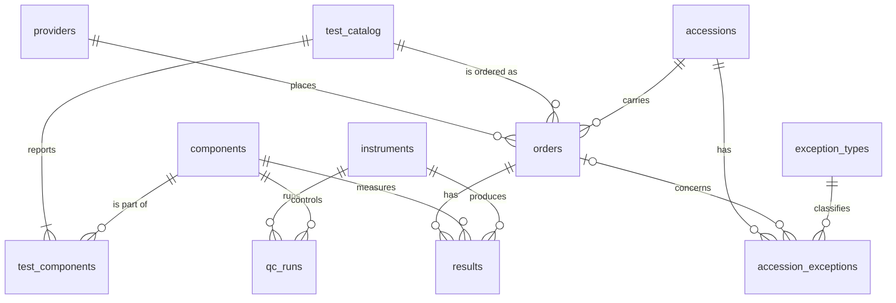

# Diagnostics & Labs data model

The data model behind the [Diagnostics & Labs board](../../app/architectures/diagnostics_labs.yaml), for the clinical lab's operations: ordered tests, specimens, the exceptions raised on them, analyte results and analyzer quality control. It gives the board's Silver layer ("conformed order, specimen, result") as tables and two views, and its Gold layer ("TAT, utilization, QC") as five metric views that dashboards, Genie Agents and SQL reuse, ready for you to certify.

All names are generic and every row in `sample_data.sql` is synthetic.

## Files

| File | What it holds |
|---|---|
| `tables.sql` | 11 Delta tables with table and column comments and informational primary and foreign keys, plus the views `accession_summary` and `order_summary` |
| `metric_views.sql` | 5 Unity Catalog metric views: every measure and dimension, with comments, synonyms and formats for Genie |
| `sample_data.sql` | Synthetic rows: 16 orders on 13 specimens, 19 analyte results, 7 exceptions and 13 QC runs, enough for every measure to return a value |
| `checks.sql` | 122 rules any data in this model must pass: keys, allowed values, order status, result flags, Westgard rules |
| `sample_tests.sql` | 57 expected values on the sample rows: one for every measure of the five metric views |

## Tables

| Table | Grain | Key columns |
|---|---|---|
| `test_catalog` | one orderable test or panel | `test_code`, `loinc_code`, `specimen_type`, `bench`, `send_out`, `tat_target_routine_hours`, `tat_target_stat_hours`, `min_retest_days` |
| `components` | one analyte | `component_code`, `loinc_code`, `units`, `critical_low`, `critical_high` |
| `test_components` | one analyte on one test | `test_code`, `component_code` |
| `providers` | one ordering provider | `provider_id`, `specialty` |
| `instruments` | one analyzer | `instrument_id`, `instrument_type`, `bench` |
| `accessions` | one specimen | `accession_id`, `specimen_type`, `collected_ts`, `received_ts`, `accessioned_ts` |
| `orders` | one test ordered for a patient | `order_id`, `patient_id`, `provider_id`, `test_code`, `accession_id`, `priority`, `patient_class`, `order_status` |
| `exception_types` | one exception type | `exception_type`, `exception_category`, `stage`, `outcome_if_unresolved` |
| `accession_exceptions` | one exception on a specimen, or on one of its tests | `exception_id`, `accession_id`, `order_id`, `resolution_status`, `resolved_ts` |
| `results` | one analyte result on an ordered test | `result_id`, `order_id`, `component_code`, `value_numeric` or `value_text`, `reference_low`, `reference_high`, `abnormal_flag`, `verified_ts`, `autoverified`, `critical_notified_ts`, `corrected_ts` |
| `qc_runs` | one control measurement on an analyzer | `qc_run_id`, `instrument_id`, `component_code`, `control_level`, `observed_value`, `target_mean`, `target_sd`, `westgard_rule`, `qc_status` |

A few choices shape the model:

- **One specimen carries several tests, and one test reports several analytes.** A metabolic panel on one serum tube gives a glucose, a potassium and a creatinine result, each with its own LOINC code, units, reference range and flag.
- **Nothing derived is stored.** Exception counts, rejection, the time an order was resulted, turnaround, the target that applies and early repeats are computed in `accession_summary` and `order_summary`.
- **Reference ranges are stored on each result as reported**, because they depend on age, sex and method. Critical limits live with the analyte.
- **An unresolved exception decides the order's status.** Its type names the outcome in `outcome_if_unresolved`: Rejected (a new specimen is needed), Not Reportable (no result), or a delay only. An exception on the whole specimen affects every test on it. An exception with an `order_id`, such as a QC failure, affects only that test.
- **The QC software evaluates Westgard rules.** `qc_runs` records the rule it reports, and `checks.sql` recomputes 1-2s, 1-3s and 2-2s from the values to confirm it.

## Metric views

| Metric view | Source | Measures | Dimensions |
|---|---|---|---|
| `order_metrics` | `order_summary` | Orders, Resulted, Open, Cancelled, Completed, Rejected and Not Reportable Orders and their rates; Avg, Median and 90th Percentile Receipt-to-Verify (h); Avg and Median Collect-to-Verify (h); Within Target Rate; STAT Within Target Rate; Straight-Through Turnaround (h); Send-out Orders and Rate; Early Repeat Orders and Rate | Order Month, Order Date, Test, Test LOINC Code, Bench, Send-out, Priority, Patient Class, Ordering Specialty, Ordering Provider, Order Status, Has Specimen Exception |
| `accession_metrics` | `accession_summary` | Accession Volume, Ordered Tests per Accession, Accessions with Exception, Exception Volume, Accession Exception Rate, Exceptions per 100 Accessions, Exceptions per Accession with Exception, Rejection-Risk Exceptions (and per 100 Accessions), Rejected Specimens, Specimen Rejection Rate, Avg Collection-to-Receipt (h) | Accession Month, Accession Date, Specimen Type, Has Exception, Specimen Rejected |
| `exception_metrics` | `accession_exceptions` | Exceptions, Unresolved Exceptions, Unresolved Rate, Accessions Affected, Avg Hours to Resolve | Accession Month, Specimen Type, Exception Type, Exception Category, Stage, Outcome if Unresolved, Resolution Status |
| `result_metrics` | `results` | Results, Abnormal Results and Rate, Critical Results and Rate, Avg Minutes to Notify Critical, Critical Calls Within 30 Minutes Rate, Autoverified Results, Autoverification Rate, Corrected Results and Rate | Verified Month, Verified Date, Analyte, Analyte LOINC Code, Test, Bench, Instrument, Priority, Abnormal Flag, Autoverified |
| `qc_metrics` | `qc_runs` | QC Runs, QC Warnings, QC Rejections, QC Failure Rate, Westgard Violations, Analyzers with QC Rejection, Mean SDI, CV (%) | Run Month, Run Date, Instrument, Bench, Analyte, Control Level, Control Lot, Westgard Rule, QC Status |

Some measures are easy to mix up, so each has its own name:

- **Receipt-to-Verify** runs from the lab receiving the specimen to the last analyte verified. It is the in-lab time, and the turnaround targets apply to it. **Collect-to-Verify** starts at collection, so it adds transport and is the time the ordering provider sees. Both count resulted orders only.
- **Straight-Through Turnaround** is Receipt-to-Verify for specimens with no exception: the time of the lab's standard path.
- **Specimen Rejection Rate** counts specimens. **Order Rejection Rate** counts tests, so one rejected tube with three tests on it counts three times.
- **Accession Exception Rate** counts specimens with at least one exception. **Exceptions per 100 Accessions** counts every exception, so it can exceed 100.
- **QC Rejections** stop patient testing on the analyte. **Westgard Violations** also count 1-2s warnings.
- **Mean SDI and CV (%)** only make sense for one analyte, control level and lot. Group by those before reading them.

## How it maps to the board

| On the board | What this model gives it |
|---|---|
| Turnaround Time use case, Turnaround & Backlog dashboard, TAT Command Center, Turnaround & Operations Agent | Receipt-to-Verify and Collect-to-Verify by bench, test and priority; Within Target Rate; STAT Within Target Rate; Open Orders by bench as the current backlog; Autoverification Rate |
| Result Autoverify | Autoverification Rate by analyzer, analyte and test |
| Test Utilization use case, Test Utilization & Cost dashboard, Utilization Hub | Orders by test, LOINC code, specialty and provider; Send-out Rate; Early Repeat Orders against each test's retest interval |
| QC & Accreditation use case and dashboard, QC & Compliance Agent | QC Failure Rate, Westgard Violations, Mean SDI and CV by analyzer and analyte, plus the quality indicators labs track for CAP accreditation: Specimen Rejection Rate, Corrected Result Rate and Critical Calls Within 30 Minutes Rate |
| Critical Value Alerts | Critical Results, Avg Minutes to Notify Critical, Critical Calls Within 30 Minutes Rate |
| Medallion Silver and Gold | The tables and the two summary views are Silver; the metric views are Gold |

Not covered yet: the revenue cycle (payers, claims, denials, net collection), cost per test and margin, backlog history (Open Orders reads the latest load, so trends need daily snapshots), analyzer repeat and rerun rates, proficiency testing, instrument uptime, digital and anatomic pathology, molecular reporting, microbiology susceptibility for AMR, and patients and encounters beyond their identifiers.

## Standards

The tables follow the messages and resources your LIS and interface engine already exchange, so you can map your Bronze HL7 v2 and FHIR feeds onto them.

| Table | FHIR R4 | HL7 v2 |
|---|---|---|
| `test_catalog` | ActivityDefinition, SpecimenDefinition | OM1, OM4 |
| `components` | ObservationDefinition | OM1, OM2 (units, reference and critical ranges) |
| `test_components` | ActivityDefinition.observationResultRequirement | OM5 |
| `providers` | Practitioner, PractitionerRole | ORC-12 |
| `instruments` | Device | OBX-18, EQU |
| `accessions` | Specimen (collection.collectedDateTime, receivedTime) | SPM (SPM-2, SPM-17, SPM-18) |
| `orders` | ServiceRequest (subject, requester, priority, specimen, status) | ORM^O01 or OML^O21: ORC, OBR, TQ1-9, PID-3, PV1-2 |
| `accession_exceptions` | Specimen.status and Specimen.condition | SPM-21 (reject reason), SPM-24 (condition) |
| `results` | Observation (code, value, referenceRange, interpretation, status, device) | ORU^R01: OBX-3, OBX-5, OBX-6, OBX-7, OBX-8, OBX-11, OBX-18 |
| `order_summary.resulted_ts` | DiagnosticReport.issued | OBR-22 |
| `qc_runs` | No core resource | IHE Laboratory Analytical Workflow (LAW) results with specimen role Q (control) |

LOINC codes the tests and analytes; the `abnormal_flag` values follow HL7 table 0078.

## Deploy

1. Replace `main.diagnostics_labs` with your catalog and schema in every `.sql` file. It is the only name the files use, and metric view YAML does not take parameters.
2. On a SQL warehouse, run `tables.sql`, then `sample_data.sql` (optional), then `metric_views.sql`. `tables.sql` and `metric_views.sql` are safe to run again.
3. Run `checks.sql` after each load. Each statement returns PASS or stops with an error that names the rule and how many rows break it.
4. With the sample rows loaded, run `sample_tests.sql`. Each statement returns PASS or stops with the measure and dimension whose value differs.
5. To change a metric view later, use `ALTER VIEW … AS` with the new YAML. It keeps the view's identity, so certification, tags and links to it stay in place.
